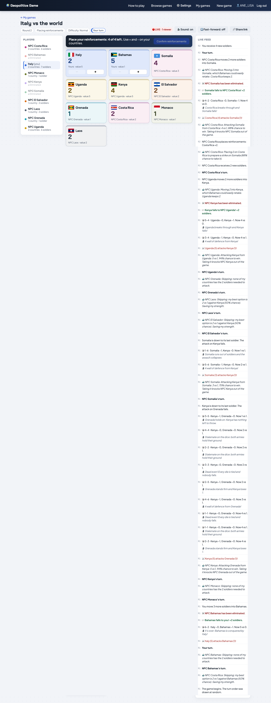
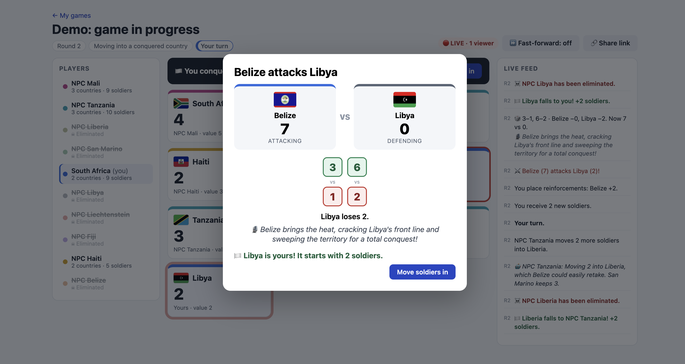
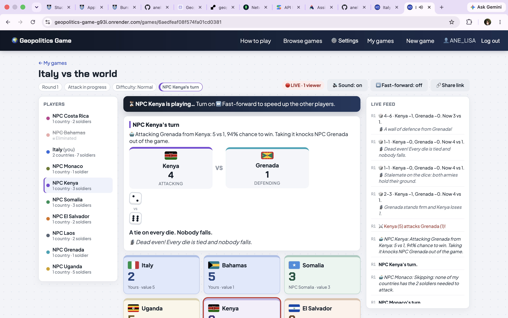
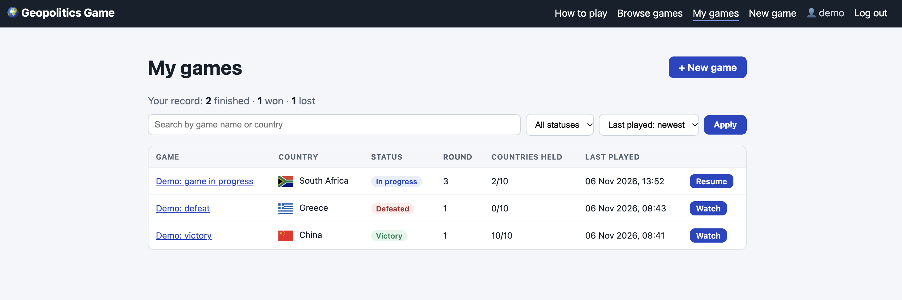
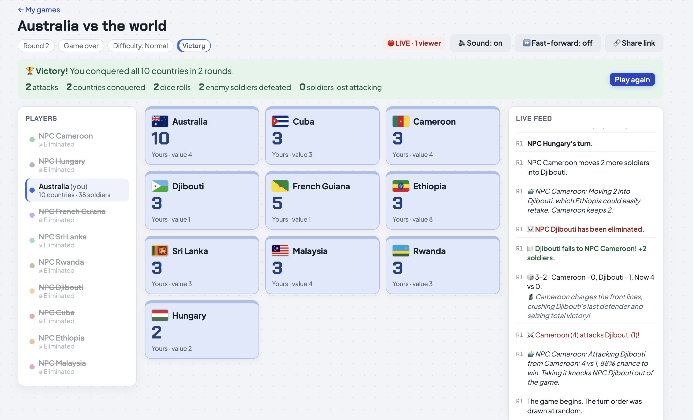
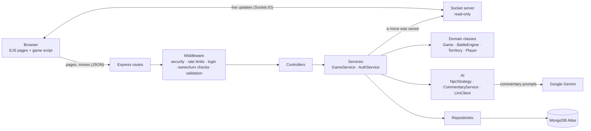
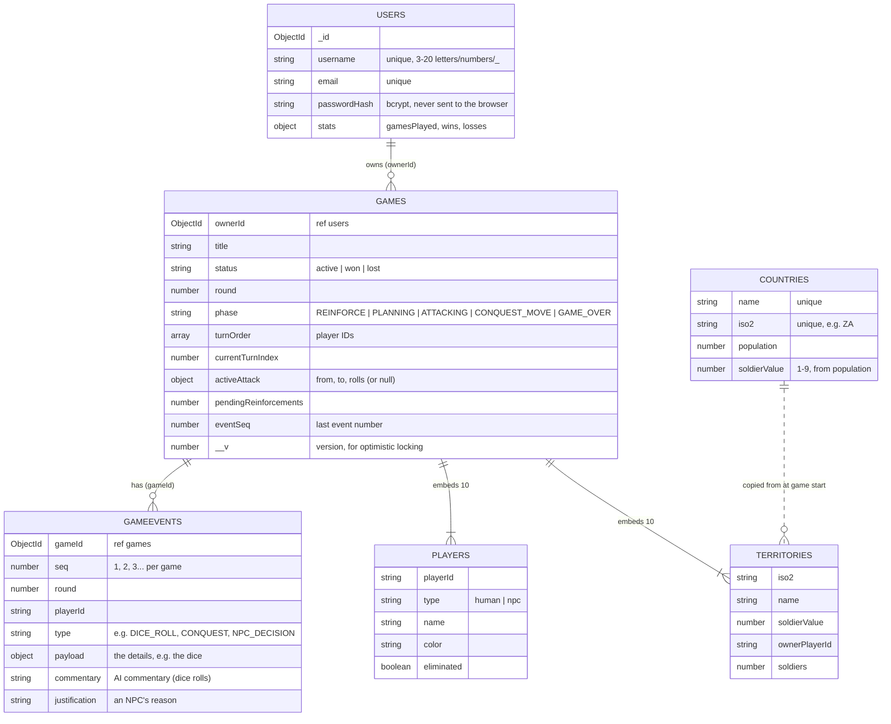

# 🌍 Geopolitics Game

A single-player, Risk-style strategy game for the web. Pick any country in the world, face 9 computer-controlled rivals who play to win, and conquer all 10 countries to claim victory. Every battle gets live AI commentary, and anyone with a game's link can watch it in real time.

Built for the **INF4001N Entrance Exam 2027** (Department of Information Systems, University of Cape Town).

**Student:** Anelisa NNXANE004

| | |
|---|---|
| **Live site** | https://geopolitics-game-g93i.onrender.com |
| **Demo login** | Given in the submission notes. Anyone can also sign up for their own account |
| **Bonus feature** | #10: a shared game link shows the game in real time |

> The site runs on Render's free plan, so the first visit after a quiet spell can take about 50 seconds while the server wakes up.



---

## Contents

1. [Features](#features)
2. [Where to find each marking criterion](#where-to-find-each-marking-criterion)
3. [Tech stack](#tech-stack)
4. [Architecture](#architecture)
5. [Database design](#database-design)
6. [Code structure, MVC and OOP](#code-structure-mvc-and-oop)
7. [Game rules as implemented](#game-rules-as-implemented)
8. [Assumptions](#assumptions)
9. [NPC strategy](#npc-strategy)
10. [AI battle commentary](#ai-battle-commentary)
11. [Bonus feature: real-time viewing](#bonus-feature-real-time-viewing)
12. [Security](#security)
13. [Testing](#testing)
14. [Running it locally](#running-it-locally)
15. [Deployment](#deployment)
16. [Known limitations](#known-limitations)

---

## Features
- **Settings and dark mode** – a ⚙️ Settings window lets you choose Light, Dark or "Match my device", and turn sound and fast-forward on or off. Your choices are saved in your browser.

- **Accounts:** sign up, log in and log out, with hashed passwords and secure sessions.
- **Multiple games:** start as many games as you like and resume any of them. **My games** lists them with search, a status filter, sorting and pages, plus your win/loss record.
- **Browse games:** anyone, logged in or not, can find and watch any game.
- **New game:** search all 234 countries (population data from Worldometers); the game picks 9 random rivals and a random turn order.
- **A full game engine** following the brief's rules: reinforcements, transfers, one attack per turn, dice battles, conquest bonuses, elimination, and winning or losing.
- **A clickable board:** choose a country, then attack an enemy or move soldiers to another of your countries, with an estimated chance of winning before you commit.
- **Animated battles:** a battle window with dice that tumble, then land showing their dots, with who won each pair. Countries flash in their new owner's colour when they change hands.
- **Sound effects** for rolls, conquests, losing a country, your turn, victory and defeat, made in the browser with the Web Audio API (no audio files), with a mute button that's remembered.
- **NPCs that play to win:** each rival calculates the exact odds of every possible attack and explains every decision in the live feed.
- **Difficulty levels:** choose Easy, Normal or Hard when starting a game. Easy NPCs only take near-certain attacks; Hard NPCs take even chances, fight on longer and gang up on whoever is winning.
- **Move-by-move playback** of the other players' turns, with **⏩ Fast-forward** that speeds it up while still showing every move.
- **AI battle commentary** on every dice roll (Google Gemini), with ready-made lines if the AI is unavailable.
- **Live spectating (bonus):** a 🔴 LIVE badge with the number of viewers, and moves appearing for watchers within a fraction of a second.
- **Game over:** Victory or Defeated banner with battle stats, confetti for a win, and the result added to the player's record.
- **How to play** page, responsive layout for phones, friendly error pages.

| | |
|---|---|
|  |  |
|  |  |
> **About the victory screenshot:** a full game takes many rounds, so to show the victory screen the "Demo: victory" game was set up with the testing-only script `scripts/almostWin.js`. It hands the player every country except one, which is left with 1 soldier, and makes it the player's turn. The final attack, the conquest and the victory screen were then played normally through the game. That is why this game shows a victory after only one turn and small battle stats. The script is never used in normal play, and "Demo: game in progress" is a normal, untouched game.

---

## Where to find each marking criterion

| Criterion | Where it is |
|---|---|
| **Database layer** | MongoDB Atlas (online). Only `src/config/db.js` connects and only `src/repositories/` queries the database; nothing else touches it. See [Database design](#database-design) |
| **Connection to database** | `src/config/db.js`: connection events are logged, it gives up after 10 s with a clear reason, and closes cleanly. `/health` reports the database status |
| **Design of the database** | Four collections, with embed-vs-reference choices explained, indexes and schema validation. See [Database design](#database-design) |
| **Coding structure** | Express MVC in layers: routes → middleware → controllers → services → domain classes and repositories. See [Code structure](#code-structure-mvc-and-oop) |
| **OOP: classes, encapsulation** | `src/domain/`: `Game`, `Territory`, `Player` → `HumanPlayer` / `NpcPlayer`, `BattleEngine`, `Dice`, plus `NpcStrategy`, `LlmClient` and `CommentaryService`. Private `#fields`, dependency injection, polymorphism |
| **Data validation, controls and security** | zod schemas on every input, every rule checked on the server, optimistic locking, cross-site request blocking, rate limits. See [Security](#security) |
| **Functionality** | Every rule in the brief, each covered by tests. See [Game rules](#game-rules-as-implemented) |
| **Works correctly; lists; searching; filtering; viewing** | 105 automated tests; My games and Browse games with search, filter, sort and pages; searchable country picker; public game pages |
| **User interface** | Clickable board, battle window with animated dice, arena for NPC turns, live feed, colour per player, responsive layout |
| **Ease of navigation** | Navbar showing the current page, How to play page, clear next-step buttons, empty states, friendly error pages, returns you to the page you wanted after logging in |
| **Security: authentication and authorisation** | bcrypt, sessions stored in MongoDB, secure cookies; only the game's owner can move, and only on their turn; visitors can only watch |
| **Sophistication and complexity** | Server-side game engine, exact-probability NPC AI, event log with move-by-move replay, Socket.IO live spectating, batched AI commentary |
| **AI application** | AI-written battle commentary (Gemini) with fallbacks; NPC decisions based on calculated odds, each with an explanation |
| **Overall effort** | All of the above, plus 105 tests, an NPC simulation script and a deployed site |

---

## Tech stack

| Layer | Choice | Why |
|---|---|---|
| Runtime and framework | **Node.js** + **Express 5** | Fast to build with; clear MVC structure |
| Views | **EJS** server-rendered pages + vanilla JavaScript modules for the game screen | No front-end build step; pages work and are readable quickly |
| Database | **MongoDB Atlas** + **Mongoose** | NoSQL (required); online; fits the game's data (see below) |
| Sessions | `express-session` + `connect-mongo` | Logins stored in MongoDB, so they survive restarts |
| Passwords | `bcryptjs` (12 rounds) | Industry-standard password hashing |
| Validation | `zod` | All input rules in one place, with friendly messages |
| Security | `helmet`, `express-rate-limit` + own middleware | Security headers, rate limits, cross-site request blocking |
| Real time | **Socket.IO** | Live spectating |
| AI | **Google Gemini** (`gemini-3.5-flash-lite`) via the OpenAI-compatible "chat completions" format | Free tier; the provider can be switched by changing three settings |
| Tests | Node's built-in test runner (`node --test`) | Works with ES modules with no setup |
| Hosting | **Render** | Deploys automatically from GitHub; supports WebSockets |

**Why MongoDB fits this game:** a game is one self-contained thing that's always loaded and saved as a whole: 10 players, 10 countries, whose turn it is, and any attack in progress. As a document, that's a single read and a single write per move, with no joins. The move history grows without limit, so it lives in its own collection. Country data is reference data that's read but never changed by the game.

---

## Architecture



**Key design decisions:**

1. **The server is in charge.** The browser never rolls dice or changes numbers; it only sends what the player wants to do (e.g. "attack Brazil from Italy"). The server checks it against the rules, rolls the dice with `crypto.randomInt`, and saves the result. This makes cheating impossible from the browser.
2. **Every move is an event.** Each action (reinforcement, NPC decision, dice roll, conquest, elimination…) is saved as a numbered event. Events drive the live feed, the move-by-move playback, fast-forward, live spectating and the game-over stats.
3. **NPC turns run on the server in one go.** When the player ends their turn, the server plays every NPC turn until it's the player's turn again and saves all the events. The browser then plays them back at normal or fast speed, so nothing is hidden.
4. **The game is saved after every roll.** Closing the browser mid-attack loses nothing; the battle carries on when the game is opened again.
5. **Optional extras never block the game.** If the AI is slow or down, ready-made commentary is used. If the live connection drops, the page checks for new moves every 15 seconds instead.

---

## Database design



| Collection | Contents | Indexes |
|---|---|---|
| `users` | One document per account | Unique `username`, unique `email` |
| `countries` | 234 countries, seeded from Worldometers by `scripts/seedCountries.js` | Unique `name`, unique `iso2` |
| `games` | One document per game, with its **10 players and 10 countries embedded** | `{ ownerId, updatedAt }` for My games; `{ status, updatedAt }` for Browse games |
| `gameevents` | Every move of every game, numbered per game | Unique `{ gameId, seq }`: fast "events after #N" and no duplicate numbers |
| `sessions` | Logins (managed by connect-mongo) | Expiry index, set automatically |

**Embed or reference?**
- **Players and countries are embedded in the game.** There are always exactly 10 of each (enforced by schema validation), they belong to that game only, and they're always read and saved together. Embedding makes every move one read and one atomic write.
- **Events are a separate collection.** A long game has thousands of events. Embedding them would make the game document grow without limit (MongoDB documents max out at 16 MB) and slow every move down.
- **Games reference their owner** (`ownerId`) because users and games are separate things with their own lifecycles.
- **A game copies its 10 countries' data at the start**, so a game in progress never changes if the reference data is updated.

**Data integrity:** Mongoose schemas enforce required fields, allowed values (`enum`), number ranges, formats (e.g. `iso2` must be two capital letters) and exactly 10 players and countries. **Optimistic locking** (`optimisticConcurrency`) gives every game a version number: if two saves of the same game arrive at once (e.g. a double-click), the second is rejected instead of overwriting the first. Win/loss records are updated with MongoDB's atomic `$inc`.

**Database access for markers:** read-only database users and project access (see the submission notes). The app itself connects with its own database user that can only read and write data, not manage the account (least privilege).

---

## Code structure, MVC and OOP

```
src/
├── server.js                 Starts the database connection, web server and Socket.IO
├── app.js                    Express app: security, sessions, routes, error handling
├── config/                   env.js (settings), db.js (database connection), session.js
├── models/                   Mongoose schemas: User, Country, Game, GameEvent         ← Model
├── repositories/             The ONLY code that queries the database                   ← data layer
├── domain/                   The game's rules as plain classes (no database, no web)
│   ├── Game.js               A whole game: phases, turns, attacks, conquest, winning
│   ├── BattleEngine.js       Dice battles
│   ├── Dice.js               Secure random dice (replaceable in tests)
│   ├── Territory.js          A country on the board
│   ├── Player.js             Player → HumanPlayer, NpcPlayer
│   └── rules.js, random.js, errors.js
├── ai/
│   ├── NpcStrategy.js        How NPCs decide, with explanations
│   ├── probability.js        Exact chance of winning an attack
│   ├── LlmClient.js          Talks to the AI model (timeout, retry)
│   └── CommentaryService.js  Battle commentary, with ready-made fallbacks
├── services/                 GameService (loads, runs and saves moves), NpcTurnRunner, AuthService,
│                             gameView (what pages may see), gameStats
├── controllers/              Turn web requests into service calls                       ← Controller
├── routes/                   Page and API URLs
├── middleware/               Login, owner/turn checks, validation, security, rate limits, errors
├── validators/               zod schemas for every input
├── sockets/                  Live spectating
├── views/                    EJS pages and partials                                     ← View
└── public/                   CSS, the game screen's JavaScript modules, site icon
scripts/                      seedCountries, simulate (NPC check), testAi, almostWin (testing only)
tests/                        105 automated tests
```

**MVC:** *models* define the data, *views* (EJS) draw pages, *controllers* handle requests. Two extra layers keep things clean: **services** coordinate a move from start to finish, and **repositories** are the only place that talks to MongoDB. Swapping the database would only change `repositories/` and `models/`.

**How a move flows:**
`POST /api/games/:id/attack/roll` → security and rate-limit checks → logged in? → game exists? → your game? → your turn? → input valid? → controller → `GameService` loads the game into the `Game` class → `Game.rollAttack()` applies the rules → NPCs play if the turn ended → AI commentary is added → the game and its events are saved → watchers are notified → the new board and events are sent back.

**OOP in practice:**
- **Encapsulation:** `Territory`, `Game`, `Player`, `Dice`, `BattleEngine`, `LlmClient` and others keep their data in private `#fields`. Soldier counts can only change through methods that enforce the rules (e.g. `removeSoldiers` refuses negatives), and `game.territories` hands out copies, so code outside the class can read the board but never change it. A test proves this.
- **Inheritance and polymorphism:** `Player` is the base class; `HumanPlayer` and `NpcPlayer` answer `type`, `isNpc` and `displayName` differently, and the game treats them the same way.
- **Dependency injection:** classes receive what they depend on through their constructor (`Dice` in `BattleEngine`, repositories in `GameService`, `fetch` in `LlmClient`, the AI in `CommentaryService`), so tests can pass in predictable stand-ins.
- **Single responsibility:** each class has one job: `BattleEngine` rolls battles, `Game` enforces turns, `NpcStrategy` decides, `NpcTurnRunner` plays NPC turns, `CommentaryService` writes commentary.

---

## Game rules as implemented

| Rule (from the brief) | How it works here |
|---|---|
| Soldiers from population | ≤5M → 1, ≤10M → 2, ≤25M → 3, ≤50M → 4, ≤75M → 5, ≤100M → 6, ≤125M → 7, ≤150M → 8, more → 9 |
| Setup | The player picks a country; 9 others are drawn at random (Fisher–Yates shuffle); each starts with its full soldier value |
| Turn order | Random. If an NPC goes first, the NPCs play straight away |
| Reinforcements | None in round 1. From round 2: 2 × countries held, all placed before anything else |
| Transfers | Between your own countries, any number of times, but not during an attack; 1 soldier always stays |
| Attack | Once per turn, from a country with 2+ soldiers, against any country you don't own |
| Dice | `min(attacker − 1, defender)` dice each; **no limit of 3** |
| Pairing | Die 1 vs die 1, die 2 vs die 2… **in the order rolled (not sorted)**; higher wins; **a tie kills nobody** |
| End of an attack | Conquest (defender at 0), failure (attacker at 1, who keeps their country), or the player stops (ends the turn) |
| Conquest | The country starts with `max(2, floor(value / 2))` soldiers; the player then chooses how many more to move in |
| Elimination | A player with no countries is out; their turns are skipped |
| Winning and losing | Holding all 10 wins; the player losing their last country ends the game |
| Fast-forward | Speeds up the playback of NPC moves; every move is still shown |
| Visibility | All countries and soldier counts are always visible; battles, dice, losses and outcomes are shown as they happen |

---

## Assumptions

- "Up to 5 million" includes exactly 5,000,000 (each band is `≤`).
- The population figures are a snapshot of Worldometers' table taken in OCTOBER 2026, including dependencies and territories (234 entries).
- The conquest bonus uses the conquered country's population-based **soldier value**, not how many soldiers it had.
- Once an attack ends (stopped, failed, or conquest plus the conquest move), the turn ends. Transfers happen before attacking.
- Soldiers that win a battle stay in the attacking country unless the player chooses to move them in.
- Reinforcements must all be placed before the player can attack, move or end their turn.
- The game ends when the human player is eliminated; NPCs aren't played on to a winner.
- NPCs play to win from the very first turn, so a player who picks a very small country can be eliminated before their first move.
- A player's record counts finished games only.
- The "Demo: victory" game was set up with `scripts/almostWin.js` (testing only) so the victory screen could be shown without playing a full game; every other game follows the normal rules.
---

## NPC strategy

Every NPC uses the same strategy (`src/ai/NpcStrategy.js`), as the brief allows.

**Difficulty levels** change four settings: the odds needed to attack (Easy 75%, Normal 55%, Hard 45%), the odds below which an attack is called off (50% / 35% / 25%), when a country counts as in danger (70% / 60% / 50%), and how much the NPCs prefer attacking the strongest rival (0 / 2 / 5 points). Games created before difficulty levels existed play as Normal.

**The odds** (`src/ai/probability.js`): the exact chance that an attack conquers its target. Each pair of dice is independent: the attacker wins 15/36 of the time, the defender 15/36, and 6/36 is a tie. From any position the calculation adds up every possible result of the next roll, weighted by its probability, then repeats from each new position, remembering answers so each position is only worked out once. It matches hand-worked answers exactly (2 vs 1 is 50%, 3 vs 1 is 75%) and a 200,000-battle simulation to within 0.1%.

**Each turn:**
1. **Reinforce:** back the best attack the new soldiers would make possible; otherwise defend the country most at risk; otherwise build one strong army.
2. **Transfer:** move spare soldiers into the planned attack, but only if that turns it into a good bet, keeping enough behind to make attacking the donor country costly.
3. **Choose an attack:** score every (own country, enemy country) pair:
   `score = P(win) × (conquest bonus + country value + 5 if it eliminates a player + 2 if the owner is the strongest rival) − (1 − P(win)) × 0.3 × (attackers − 1)`.
   Attack the best one only if `P(win) ≥ 55%`; otherwise skip the turn.
4. **Keep rolling or stop:** after each roll, stop if the chance drops below 35% or the army falls below a third of what it started with.
5. **After a conquest:** move half the spare soldiers in if the new country could easily be retaken; otherwise keep the army together.

Every decision is saved with a plain-English reason that appears in the feed and the arena, e.g. *"Attacking Montenegro from Benin: 3 vs 1, 75% chance to win. Taking it knocks NPC Montenegro out of the game."*

**Checking it:** `node scripts/simulate.js 200` plays 200 complete games without a database. Results: 200 games, **0 illegal moves**, average game length 61.7 rounds (shortest 1, longest 208). Across those games the NPCs chose to attack 11,756 times, skip 8,819 times, stop an attack 1,815 times and transfer soldiers 152 times. The NPCs attack, skip, stop, reinforce, transfer and move in after conquests.

---

## AI battle commentary

- After each move, all its dice rolls (one when the player rolls, or several battles when the NPCs play) are sent to the AI in **a single request**, which asks for one vivid sentence per roll. That saves time and free-tier quota.
- The prompt gives the real dice and losses, and the rules: game terms only, no real-world politics, no graphic violence, and never invent numbers.
- The answer is checked: it must be a list with a line for each roll. Anything missing or malformed gets a **ready-made line** instead.
- Time limits (5–15 seconds depending on the number of rolls) mean a slow AI can never freeze the game. If the AI is down, out of quota or has no key, the game carries on with ready-made lines.
- Commentary is saved with each dice roll, so watchers and the history see the same lines.
- AI text is always shown as plain text, never as HTML, so it can't inject anything into the page.
- **Provider:** Google Gemini through its OpenAI-compatible endpoint. `LlmClient` uses the common "chat completions" format, so Groq, OpenAI and others work by changing `LLM_BASE_URL`, `LLM_MODEL` and `LLM_API_KEY`.

`node scripts/testAi.js` checks the AI settings with one real request.

---

## Bonus feature: real-time viewing

**Bonus #10: "Game URL shared allows viewing in real time."**

- Every game page opens a **Socket.IO** connection and joins that game's room.
- When a move is saved, the server tells everyone in the room. Each page then fetches the new moves through the normal API, so each viewer still only gets what they're allowed to see, and plays them back.
- A **🔴 LIVE · N viewers** badge shows how many people have the game open.
- Watchers need no account. **🔗 Share link** copies the game's address.
- **The live connection is read-only:** the only thing a browser can say is "I'm watching this game", and the game ID is checked first. Every move still goes through the logged-in, checked API.
- If the connection drops, the page falls back to checking every 15 seconds.

Measured: a watcher's screen shows a move about **0.1 seconds** after it's made.

The design also covers parts of other suggested extras: game history (the event log), basic analytics (game-over stats and win/loss records), and protection against cheating by closing the browser mid-attack (the game is saved after every roll).

---

## Security

**Logins:**
- Passwords hashed with bcrypt (12 rounds); the hash is never sent to the browser.
- Sessions are stored in MongoDB. Cookies are `httpOnly`, `secure` on the live site, and `sameSite=lax`.
- A new session ID on every login (protects against session fixation).
- Login errors don't reveal whether a username exists.
- Logins and sign-ups are limited to 10 failed attempts per 15 minutes.

**Access control:**
- Every move is checked, in order: logged in → game exists → it's your game → it's your turn → the input is valid → the rules allow it.
- Visitors can watch any game but get `401` for any move; other players get `403`.
- The server rolls all dice and enforces every rule, so the browser can't cheat.

**Input validation:**
- zod schemas on every request: types, lengths, formats and ranges (e.g. soldier counts must be whole numbers between 0 and 1000; country codes must be two capital letters).
- Game IDs must match the 24-character ID pattern before the database is asked.
- Search text is escaped before it's used in a search.
- **NoSQL injection** (e.g. `{"$ne": null}` instead of a username) is rejected by validation before it reaches the database. Mongoose's global `sanitizeFilter` was considered but not used, because it also neutralises the app's own `$gt`/`$in` queries.

**Web attacks:**
- **Cross-site request forgery:** any change (move, login, logout, new game) that comes from another website is refused, using the browser's `Sec-Fetch-Site` header with an `Origin` check for older browsers.
- The game API only accepts JSON, which other websites' forms can't send.
- **XSS:** EJS escapes all output; the game screen builds pages with `textContent`, never `innerHTML` with data; the game's starting data is escaped so it can't break out of its `<script>` tag.
- **Helmet** sets security headers, including a Content Security Policy (scripts only from this site), `X-Frame-Options`, `Strict-Transport-Security` and `X-Content-Type-Options`.
- Request bodies are limited to 10 KB; the API is limited to 120 requests a minute per player.

**Reliability and secrets:**
- Optimistic locking stops double-clicks applying a move twice.
- Error pages never show technical details; errors are logged on the server.
- Secrets (database password, session secret, AI key) live in environment variables, never in the code; `.env` is never committed.
- The app's database user can only read and write data; markers' database users are read-only.

These protections are covered by tests (`tests/security.test.js`, `tests/gameAccess.test.js`, `tests/liveUpdates.test.js`) and were checked with real attack-style requests against the live site.

---

## Testing

**105 automated tests**, run with `npm test` (no database or internet needed: tests use stand-ins for the database, dice and AI).

| Area | Test files |
|---|---|
| Rules and battles | `rules`, `battleEngine`, `territory`, `game` (every rule in the brief, including its worked examples) |
| NPCs | `probability`, `npcStrategy`, `npcTurnRunner` (thousands of moves across 25+ complete games, all legal) |
| Services | `gameService`, `gameServiceActions`, `gameResults`, `replay` (the browser's replay always matches the server's board) |
| Security and access | `security`, `gameAccess`, `models`, `listSchemas` |
| AI and live updates | `llmClient`, `commentary`, `liveUpdates` (a real Socket.IO server) |

The game was also tested by hand on the live site against a full checklist: accounts, every rule, NPCs, fast-forward, commentary, live spectating, access control, victory and defeat, and phone layout.

---

## Running it locally

**You need:** Node.js 22 or newer, a MongoDB database (a free MongoDB Atlas cluster works), and optionally a free Gemini API key from https://aistudio.google.com for AI commentary.

```bash
git clone https://github.com/anelisa-lab/Geopolitics-Game.git
cd Geopolitics-Game
npm install
cp .env.example .env        # then fill in your own values
npm run seed                # loads the 234 countries into the database
npm run dev                 # starts the app at http://localhost:3000
```

**Settings (`.env`):**

| Name | Required | What it is |
|---|---|---|
| `MONGODB_URI` | Yes | MongoDB connection string, ending in `/geopolitics` before the `?` |
| `SESSION_SECRET` | Yes | A long random string. Make one with `node -e "console.log(require('crypto').randomBytes(32).toString('hex'))"` |
| `PORT` | No | Defaults to 3000 |
| `LLM_API_KEY` | No | Gemini API key. Without it, ready-made commentary is used |
| `LLM_BASE_URL` | No | Defaults to Gemini's OpenAI-compatible endpoint |
| `LLM_MODEL` | No | Defaults to `gemini-3.5-flash-lite` |

**Other commands:**

| Command | What it does |
|---|---|
| `npm test` | Runs all 105 tests |
| `npm start` | Starts the app without auto-restart (as on the live site) |
| `node scripts/simulate.js 200` | Plays 200 NPC games without a database and reports illegal moves (should be 0) |
| `node scripts/testAi.js` | Checks the AI settings with one real request |
| `node scripts/almostWin.js GAME_ID` | **Testing only:** sets up a game one conquest from victory, to check the victory screen |

---

## Deployment

The live site runs on **Render** (free web service), deployed automatically whenever `main` is pushed to GitHub. Build command: `npm install`. Start command: `npm start`. Environment variables on Render: `MONGODB_URI`, `SESSION_SECRET`, `NODE_ENV=production` and `LLM_API_KEY`. The database is MongoDB Atlas (free M0 cluster), with network access open to Render (which has no fixed IP address); access still requires the database username and password.

---

## Known limitations

- **Cold starts:** on Render's free plan, the first visit after 15 quiet minutes takes about 50 seconds.
- **AI quota:** the free Gemini tier has rate limits; when they're hit, ready-made commentary lines are used for that move.
- **One server:** rate limits and live connections are kept in the server's memory. Running several servers would need a shared store (e.g. Redis).
- **All games are public:** anyone with a game's link, or through Browse games, can watch it, as the brief describes. Only the owner can play.
- There's no password reset and no way to delete a game.
- The win/loss record counts games finished after the record feature was added.
